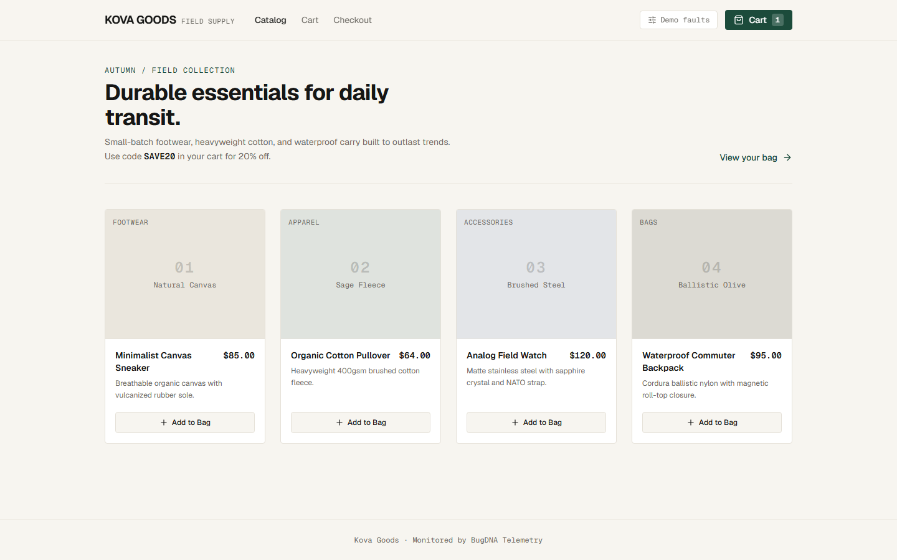
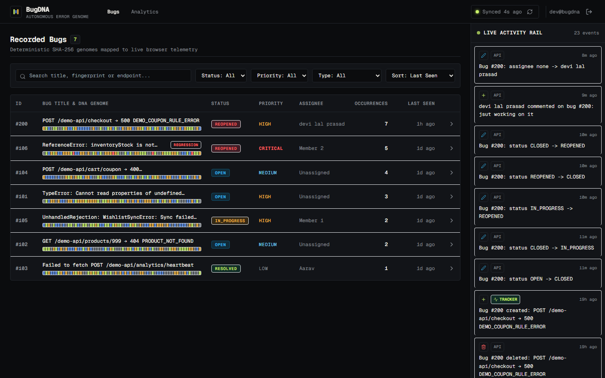
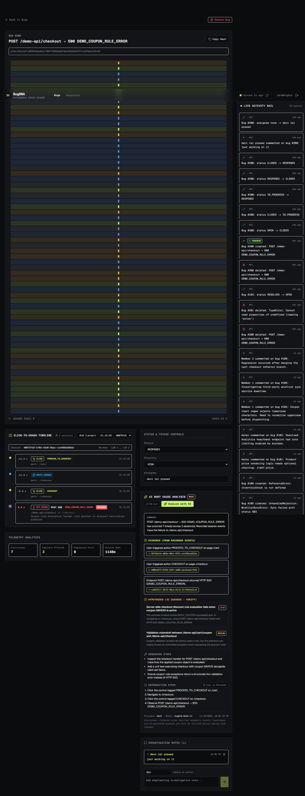
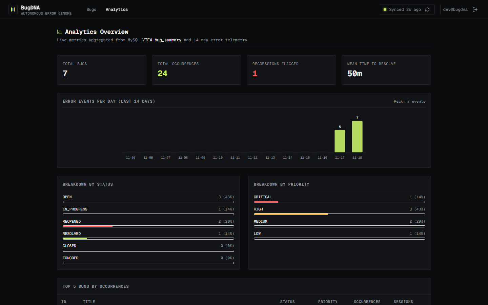
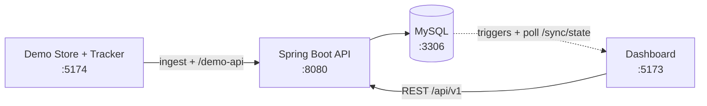

# BugDNA

Self-hosted, privacy-first error tracking — every bug gets a deterministic SHA-256 “genome,” a click-to-crash timeline, and a dashboard that stays in sync with MySQL.

## Features

- **SHA-256 fingerprint grouping.** Errors are reduced to a canonical string and hashed with SHA-256. MySQL `UNIQUE(project_id, fingerprint)` is what keeps one bug from becoming two rows.
- **Click-to-crash timeline.** The tracker records tagged clicks (`data-bugdna-action`), route changes, JavaScript errors, and failed `fetch` calls so you can see the lead-up to a crash.
- **Regression detection.** If a `RESOLVED` or `IGNORED` bug is seen again with the same fingerprint, it is reopened automatically and flagged as a regression.
- **Two-way MySQL sync.** Six `AFTER` triggers write `activity_log`. The dashboard polls `GET /api/v1/sync/state` every 5 seconds, so an `UPDATE` in the MySQL CLI appears in the UI — and a UI edit is visible with `SELECT`.
- **Privacy-first.** Input values, cookies, auth headers, bodies, and query strings are never collected. Emails, tokens, and long digit runs are masked on the client and again on the server (OWASP Logging Cheat Sheet).
- **AI root-cause, mock by default.** Analysis must cite real event ids; anything that does not is dropped. `AI_PROVIDER=mock` runs the demo with no API key. Optional Gemini or OpenAI providers can be enabled when a key is configured.

## Screenshots









## Architecture



The demo store embeds `tracker/bugdna-tracker.js`. The tracker batches events to `POST /api/v1/ingest`. The API persists them in MySQL (Flyway migrations V1–V3: schema, triggers and `bug_summary` view, seed data). The dashboard reads and updates the same database through the API, and notices out-of-band CLI changes via trigger-written `activity_log` rows.

## Tech stack

| Layer | Stack |
|---|---|
| API | Java 21, Spring Boot 4.1.2, Spring Data JPA, Flyway, HikariCP, embedded Tomcat |
| Database | MySQL 8.0 / 8.4 (InnoDB, utf8mb4), or Docker Compose (`mysql:8.4`) |
| Dashboard | React 19, Vite 8, Tailwind CSS, React Router 7 |
| Demo store | React 19, Vite 8, Tailwind CSS, React Router 7 |
| Tracker | Zero-dependency ES module, tested with Vitest |

## Project structure

```
backend/                 Spring Boot API (port 8080)
  src/main/resources/db/migration/   Flyway V1 schema, V2 triggers/view, V3 seed
dashboard/               Developer dashboard (port 5173)
demo-store/              Kova Goods shop with the tracker embedded (port 5174)
tracker/                 bugdna-tracker.js and its unit tests
database/                setup.sql, demo_queries.sql, reset_demo.sql
docs/                    DEMO_SCRIPT, ER, TEST_REPORT, VIVA, screenshots
docker-compose.yml       Optional MySQL 8.4 service
start-demo.ps1           Windows launcher for API + dashboard + store
reset-demo.ps1           Reset live demo data between runs
```

## Prerequisites

- JDK 21 or newer
- Node.js 20 or newer
- MySQL 8.0 / 8.4, **or** Docker Desktop
- PowerShell, if you use the one-command Windows launcher

## Quick start

### Option A — Windows launcher

MySQL must already be running: either the local service after a one-time `database/setup.sql` as root, or `docker compose up -d`.

```powershell
.\start-demo.ps1
```

This starts the API, dashboard, and demo store in separate windows and waits for `http://localhost:8080/api/v1/health`.

To reset live demo rows between runs:

```powershell
.\reset-demo.ps1
```

### Option B — Manual (Windows, macOS, or Linux)

```bash
# 1. Start MySQL, then create the database and app user (once, as root)
#    Windows:  Get-Content database/setup.sql | mysql -u root -p
#    macOS/Linux:
mysql -u root -p < database/setup.sql

#    Or, instead of a local server:
docker compose up -d

# 2. Optional: copy env examples (defaults in application.yml match .env.example)
cp backend/.env.example backend/.env
cp dashboard/.env.example dashboard/.env
cp demo-store/.env.example demo-store/.env

# 3. API on :8080 (Flyway applies V1–V3 on startup)
cd backend
./mvnw spring-boot:run          # Windows: .\mvnw.cmd spring-boot:run

# 4. Dashboard on :5173
cd dashboard
npm install
npm run dev

# 5. Demo store on :5174
cd demo-store
npm install
npm run dev
```

Open [http://localhost:5173](http://localhost:5173) and sign in with the dev credentials in `backend/.env.example`. Open [http://localhost:5174](http://localhost:5174) for the shop.

## Ports

| Port | Process | How it starts | Role |
|---:|---|---|---|
| 5173 | Vite dev server | `npm run dev` in `dashboard/` | BugDNA dashboard |
| 5174 | Vite dev server | `npm run dev` in `demo-store/` | Kova Goods demo shop |
| 8080 | Embedded Tomcat (Spring Boot) | `./mvnw spring-boot:run` in `backend/` | REST API `/api/v1/**` and `/demo-api/**` |
| 3306 | MySQL | Local service (e.g. `MySQL80`) or `docker compose up -d` | Database `bugdna` |

There is no Vite proxy. The browser calls `http://localhost:8080` directly; CORS origins are configured with `BUGDNA_CORS_ORIGINS`.

## Configuration

Copy each `.env.example` to `.env` in the same folder. **Never commit `.env` files or real secrets.** Placeholders below are for local development only.

| Variable | App | Example | Purpose |
|---|---|---|---|
| `DB_URL` | backend | `jdbc:mysql://localhost:3306/bugdna?...` | JDBC URL |
| `DB_USER` | backend | `bugdna` | Database user |
| `DB_PASSWORD` | backend | `CHANGE_ME_LOCAL_ONLY` | Database password (placeholder) |
| `BUGDNA_DEV_USER` | backend | `dev` | Dashboard login (dev only; no Spring Security user store) |
| `BUGDNA_DEV_PASSWORD` | backend | see `.env.example` | Dashboard login (change locally) |
| `BUGDNA_CORS_ORIGINS` | backend | `http://localhost:5173,http://localhost:5174` | Allowed browser origins |
| `AI_PROVIDER` | backend | `mock` (`mock` \| `gemini` \| `openai`) | Falls back to `mock` when no key is set |
| `AI_MODEL` | backend | `gemini-2.5-flash` | Model name for a live provider |
| `GEMINI_API_KEY` | backend | *(empty)* | Optional Gemini key |
| `OPENAI_API_KEY` | backend | *(empty)* | Optional OpenAI key |
| `VITE_API_BASE` | dashboard | `http://localhost:8080/api/v1` | Dashboard API base |
| `VITE_API_BASE` | demo-store | `http://localhost:8080` | Store + tracker origin |
| `VITE_BUGDNA_PROJECT_KEY` | demo-store | `demo-store-dev-key` | Sent as `X-BugDNA-Key` on ingest |

`database/setup.sql` creates the `bugdna` user with the same documented placeholder password. Change it in your local MySQL; do not commit a real password.

## Tests

```bash
# Backend (JUnit + Spring Boot Test, in-memory H2 — no MySQL required)
cd backend && ./mvnw test

# Tracker (Vitest)
cd tracker && npm install && npm test

# Frontend production builds
cd dashboard && npm ci && npm run build
cd demo-store && npm ci && npm run build
```

## Demo walkthrough (SAVE20)

1. Start MySQL, the API, the dashboard, and the demo store (Option A or B above).
2. Open [http://localhost:5174](http://localhost:5174), add an item to the bag, and apply coupon **SAVE20** — it succeeds.
3. Click **Checkout**. The shop shows an error (`POST /demo-api/checkout` returns `500 DEMO_COUPON_RULE_ERROR` on purpose).
4. Open [http://localhost:5173](http://localhost:5173) and sign in. Within about 5 seconds a new bug appears, with a `TRACKER` entry in the live activity rail and a click-to-crash timeline (page view, apply coupon, checkout, 500).
5. Optional two-way sync check: in the MySQL client run `UPDATE bugs SET status='RESOLVED' WHERE id=104;` — the dashboard row updates within 5 seconds, with a `MYSQL_CLI` activity entry. Changing status in the UI is visible with `SELECT` in the client.

A fuller 10-scene script is in [docs/DEMO_SCRIPT.md](docs/DEMO_SCRIPT.md).

## Documentation

- [docs/DEMO_SCRIPT.md](docs/DEMO_SCRIPT.md) — live presentation script
- [docs/VIVA.md](docs/VIVA.md) — viva Q&A, including “Why not Sentry?”
- [docs/ER.md](docs/ER.md) — ER diagram (8 tables, triggers, `bug_summary` view)
- [docs/TEST_REPORT.md](docs/TEST_REPORT.md) — TC-01…TC-12 verification report
- [database/demo_queries.sql](database/demo_queries.sql) — MySQL CLI demo queries
- [tracker/README.md](tracker/README.md) — three-line embed guide for the tracker

## License

[MIT](LICENSE) © 2026 Aarav Pilania
